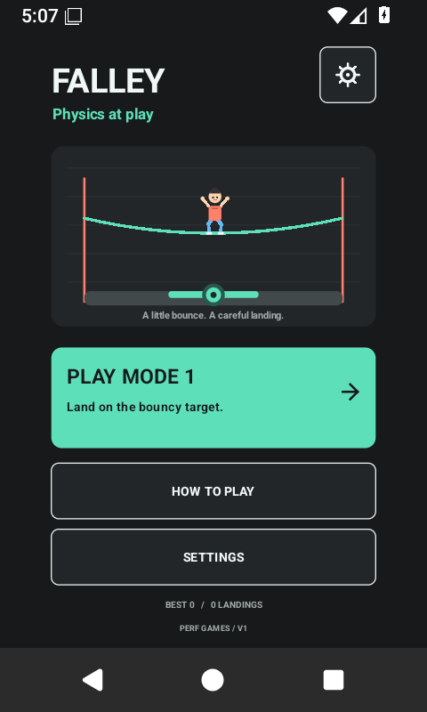

# Falley — V1

**Physics at play.** An offline Android game with a simple human character, elastic ropes and a bouncy landing target. V1 has one finite Mode 1 course. Land on the marked target to win.



[Download the V1 test build](https://github.com/rohitashmathur/Falley/releases/tag/v1.0.0). This is a debug-signed Android testing release, not a Google Play production submission.

## Play

- Open **Play Mode 1** from Home. Descend through six ropes and reach the ground target.
- **Tap** the arena or **Jump** for an upward impulse. Rope landings also produce a small natural jump.
- **Tilt** to steer, or **drag horizontally** for touch steering. Touch works with motion off or unavailable.
- Points increase weight and load. Heavy impacts snap ropes; touching a narrowing coral side rail ends the run.
- Land with the figure's contact area inside the green target to win. The floor compresses and produces a short real bounce before **Landed!** appears.
- A landing outside the target bounces without awarding a win; steer back for another attempt. Restart is always available.

The human is drawn directly with head, body and articulated limbs. Landing bends the knees, ascent raises/tucks the limbs, and descent spreads and moves them. Collision uses a compact proxy aligned to the drawn feet, not a full articulated ragdoll.

## A simple Frontline framework

Falley follows Frontline's native Android Canvas, small profile, persisted preferences and screen-navigation conventions. It keeps only Home, Mode 1, Settings, How to Play, Pause and Results. Gameplay freezes in menus and during lifecycle pause. Android Back routes through those screens; supported Back callbacks are used on Android 13+.

Settings replace difficulty choices with **motion feel**:

- **Motion steering ON/OFF**. Gyro plus accelerometer when available; filtered accelerometer fallback otherwise.
- **Loose / Balanced / Tight**. Loose responds faster to smaller tilts; Tight is calmer and needs more tilt; Balanced is the default.
- **ZERO / Center my hold**. Centers the current comfortable pose. A fresh pose auto-centers after resume; calibration is session-based.
- **Sound Effects**. Optional short system-generated tones, with no downloaded audio assets.
- **Vibration**. Optional touch/landing/result feedback.

There is **no music** or music setting. Motion, feel, sound and vibration choices persist locally, alongside best score, successful landings and fastest win. An unfinished run is not saved across process death.

## Install

Requires Android 7.0 / API 24 or newer. Download `Falley-V1-1.0.0-debug.apk`, transfer it to a phone and open it using your file app, allowing installation from that app when prompted. Or use USB debugging:

```powershell
adb install -r .\Falley-V1-1.0.0-debug.apk
adb shell am start -n com.perfgames.falley/com.perfgames.ropelab.MainActivity
```

Falley uses application ID `com.perfgames.falley`, separate from the earlier Rope Lab prototype. They can coexist; old prototype scores/preferences are not imported. The internal Java namespace remains unchanged for continuity.

## Build and test

Portable Windows builder: JDK 17, Android SDK **platform 36** and **build-tools 35.0.0**. Run from the project root:

```powershell
.\scripts\build-android.ps1 -SdkRoot 'C:\path\to\android-sdk' -JdkRoot 'C:\path\to\jdk-17'
.\scripts\test-physics.ps1 -JdkRoot 'C:\path\to\jdk-17'
```

Alternatively set `ANDROID_HOME` and `JAVA_HOME`. Output is `Falley-debug.apk`; unique staging directories and the ignored debug key live in `build/`. Keep the local key to install later debug updates over this build. It is deliberately absent from the public source archive.

Gradle files use AGP 8.10.1, Gradle 8.11.1, JDK 17 and compile/target SDK 36. A wrapper is not bundled; with the matching Gradle installed and SDK configured, use `gradle :app:assembleDebug`. That route has not been verified here; the portable SDK builder was used.

Native tests require an already running disposable emulator, an installed Falley APK and platform 35 for compiling the reflection-only test harness:

```powershell
.\scripts\test-ui.ps1 -Device emulator-5584 -SdkRoot 'C:\path\to\android-sdk' -JdkRoot 'C:\path\to\jdk-17'
```

The native runner sends real touch and Back events, checks preferences and navigation, captures screens, then restores preferences/display overrides and removes its test APK. Target/death tests use controlled physics setup. See `android-tests/` and `screenshots/v1/`.

## Implemented rules

Six fixed 25-node elastic ropes lead to ground at world Y1590. Simulation uses fixed 240 Hz steps and bounded frame catch-up. Gravity remains constant; mass grows with score and affects impact load and jumping. Survival earns 10 points/second, each rope cut adds 30, and a target landing adds 100. Walls narrow with time/score, ending runs that stall too long. The camera stops where the target floor stays visible.

A win freezes gameplay input and score while the short floor bounce continues. Results are recorded once. No levels, extra modes, accounts, analytics, advertising, purchases or backend are included.

## Verification — 14 October 2026

- Portable SDK build and v2/v3 APK signatures: **PASS**; version 1.0.0 / code 3 / target API 36.
- Physics suite: **PASS**, including a complete finite-course steering win, landing/automatic jump, cuts, off-target recovery, full target bounds, winning input/score lock, bounce, floor/camera limits, reset and 100,000 seeded stability steps.
- Motion filter: **PASS**, 17 scenarios for presets, calibration, fallback, timing, gyro response and invalid samples.
- Local profile: **PASS**, 15 scenarios for defaults, sanitization, settings and win/loss records.
- Native final APK: **PASS**, Android 15/API 35 and Android 16/API 36, each at 480x800/240 dpi and 720x1600/320 dpi. Four suites total 750 checks and 48 screenshots.
- Native checks cover actual touch and system Back, preference persistence through Activity recreation, pause timing, jump/drag, restart/replay and results. Controlled fixtures verify target bounce/win, rail death and off-target recovery. Their screenshots may show a 0.0-second staged win; those are test setups, not a natural player session.
- Home, settings, gameplay and target/result screenshots were visually inspected with no clipping or system-bar overlap.

See `BUILD_STATUS.md` for the delivered APK checksum and native logs under `screenshots/v1/api35/` and `api36/`.

## Known gaps and V2

Real-phone motion comfort, haptic/audio feel, battery cost and subjective fun still need testing. Balance is provisional; repeated air jumps can delay descent and earn survival points. Ropes do not collide with one another, and cut ropes stop catching the figure. English-only Canvas controls do not yet provide a full set of independent TalkBack controls. Android versions before 15 and tablet/landscape behavior have not been run here.

API 36 targeting is implemented, but this release remains a debug APK: release-signed AAB generation, Google Play setup/privacy disclosures and production readiness are not completed. Motion samples and preferences stay on-device; the inspected app has no network permission, ads or analytics.

**V2 adds more stages and game modes.** Before that, run short physical-phone sessions to tune motion feel, rope response, jump cadence and the target landing. Keep V1 focused on this one complete loop.
