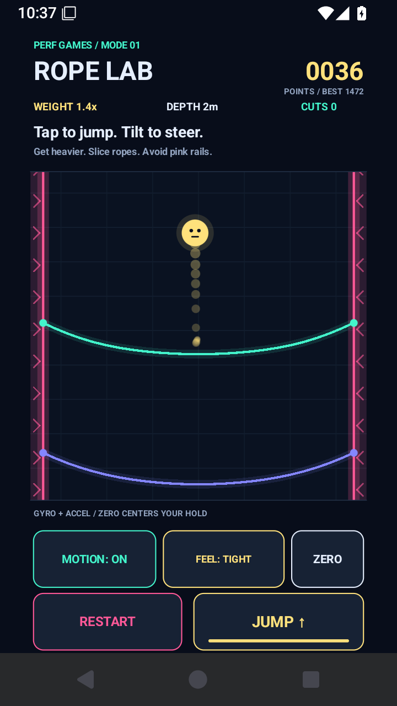

# Rope Lab — Perf Games prototype 0.2.0

Android-only, offline, portrait **Mode 1**: keep a ball alive as gravity pulls it through elastic ropes. Points increase its weight, heavier impacts cut ropes, and glowing side walls steadily close in. Touch a side wall and the ball blasts apart. Tap to jump; steer with phone motion or a horizontal touch drag. The focus is testing physics and controls on a phone.



This replaces the 0.1.0 ring-chasing rope-drag toy. There is one test arena, one ball and one mode, without levels, monetization, network services or a backend.

## Play and tune

- **Tap the arena** or press **JUMP** for an upward impulse. Jump has a 0.30-second cooldown; a heavier ball jumps less strongly. Holding a finger does not auto-jump.
- **Drag horizontally in the arena** to steer. This remains available with motion enabled and supplies touch-only play when motion is disabled or no accelerometer is present.
- **MOTION ON/OFF** enables or disables sideways motion steering. When an accelerometer is available, motion starts enabled. Gravity always pulls downward.
- Hold the phone in a comfortable portrait pose. The first valid sensor sample automatically centers it; press **ZERO** to center the current pose again. Returning from the background clears stale sensor samples and centers the next pose.
- The sensitivity button cycles **LOOSE → BALANCED → TIGHT**. Loose has more gain, less dead zone and faster response. Tight has less gain, a wider dead zone and more smoothing. Balanced is the initial choice. Compare all three during short runs.
- **RESTART** begins a fresh run and repairs the ropes. The best score is kept locally; the sensitivity and motion preferences are kept locally too.

The gyroscope provides quick rotation response and the accelerometer supplies the gravity reference that corrects drift. Phones without a gyroscope use filtered accelerometer steering. No motion hardware is required for touch play. Tilting right should move the ball right; ZERO compensates for a comfortable resting angle rather than forcing a flat phone.

## Rules implemented

- Constant downward gravity with a fixed 240 Hz simulation and bounded frame catch-up.
- Six elastic, 25-node Verlet ropes recycle below the camera as the ball descends. They sag, react to impacts and visibly separate when cut.
- Survival earns **10 points per second**; each rope cut adds **30 points**.
- Ball mass grows as `min(6, 1 + score × 0.012)`. Its radius grows slightly to show the weight change. Mass increases the force on ropes and reduces the jump impulse; it does not make gravity itself stronger.
- A downward contact cuts a segment when weight plus impact load exceeds that rope's strength. The cut persists while the rope is visible. Its torn ends keep animating but no longer catch the ball; recycling repairs it.
- Side walls narrow with elapsed time and score. Their terminal safety bound is a **38-unit gap**, smaller than a fully weighted ball: even a perfectly centered idle run eventually ends. Contact is lethal, including a wall closing onto the ball. There is no floor death; the camera follows downward progress.
- Neon ropes, tension glow, a ball trail, weight/score readouts, jump cooldown feedback and a blast on death provide immediate visual feedback.
- Pause/resume releases touch state and unregisters/restarts sensor listeners. The portrait drawing area accounts for Android system bars.

`Physics.java` and `MotionSteering.java` are independent of Android and can be tested on a desktop JDK. `MainActivity.java` draws the arena and handles touch, sensors and local preferences. Tuning is intentionally kept in these small files for prototype iteration.

## Why native Android

The existing local **Perf Games** project uses Java, Android Canvas and a portable Android SDK builder. Rope Lab follows those conventions with a separate package (`com.perfgames.ropelab`). This repository contains the standalone Rope Lab source project.

The initial prototype was inspired by the uploaded recording's ball/egg deforming a stack of colored strings. Mode 1 changes that inspiration into the requested gravity, increasing weight, rope cuts and narrowing sideline mechanic. The recording is not an app asset.

## Install on Android

[Download the 0.2.0 test APK](https://github.com/rohitashmathur/RopeLab/releases/tag/v0.2.0). The builder creates `RopeLab-debug.apk` in this directory for **Android 7.0 / API 24 or newer**. It is a locally debug-signed prototype. Transfer it to a phone, open it, and permit installation from your chosen file app when Android prompts. With an Android SDK and USB debugging:

```powershell
adb install -r .\RopeLab-debug.apk
adb shell am start -n com.perfgames.ropelab/.MainActivity
```

The app needs no network, account or special runtime permission. Keep the generated `build/debug.keystore` locally if you want later APKs to install over this one; it is ignored by source control and should not be published. An APK signed with another key requires uninstalling the old app first, which clears its local score/preferences.

## Build and test — Windows

Install **JDK 17**, Android SDK **platform 35** and **build-tools 35.0.0**. The portable build script needs no Gradle or third-party runtime library. Run from this directory:

```powershell
.\scripts\build-android.ps1 -SdkRoot 'C:\path\to\android-sdk' -JdkRoot 'C:\path\to\jdk-17'
.\scripts\test-physics.ps1 -JdkRoot 'C:\path\to\jdk-17'
```

Alternatively set `ANDROID_HOME` and `JAVA_HOME`, then run the scripts without arguments. Build intermediates, test classes and the local debug key go into `build/`; the final APK goes into the project root. The builder checks compilation, DEX conversion, APK alignment and signature verification.

Standard Android Gradle files are supplied using AGP 8.7.3. With JDK 17 and Gradle 8.9 installed, set `ANDROID_HOME` or an untracked `local.properties`, then run `gradle :app:assembleDebug`. This route needs plugin-repository access; a Gradle wrapper is not bundled. See [Android command-line build documentation](https://developer.android.com/build/building-cmdline).

Motion implementation references: [Android motion sensors](https://developer.android.com/develop/sensors-and-location/sensors/sensors_motion) and [sensor lifecycle and sampling](https://developer.android.com/develop/sensors-and-location/sensors/sensors_overview).

## Verification — 12 October 2026

**Portable physics tests: PASS.** Survival scoring and mass growth/cap, light-ball catch versus heavy-ball cut, break bonus, persistent cut, narrowing bounds, both lethal sidelines, death input lock, reset, actual jump ascent and cooldown, mass-adjusted jump, bilateral steering, downward camera and rope recycling, passive/repeated-jump runs ending in wall crush, plus a seeded **100,000-step** mixed jump/steering run checking finite ball and rope states.

**Portable motion tests: PASS.** Startup neutral pose, accelerometer-only steering in both directions, ZERO and held calibrated pose, resume reset, sensitivity ordering, similar response at 30 Hz and 120 Hz, finite/capped output, gyroscope response before another accelerometer sample, invalid/stale/freefall/shake input rejection and gravity correction after gyro rotation.

**Mode 1 APK and Android smoke checks: PASS.** The 0.2.0 APK built, verified its v2/v3 signature, installed and launched on an Android 15 / API 35 emulator. Screen checks covered 720x1280 at 320 dpi and 1080x2400 at 420 dpi. Tap/JUMP produced visible ascent; motion OFF plus horizontal drag steered into a lethal wall; simulated accelerometer and gyroscope input with motion ON steered into a wall and displayed the blast. Restart, ZERO, Loose/Balanced/Tight cycling, pause/resume, score/weight growth, rope cuts and shrinking rails were exercised. No AndroidRuntime crash output appeared during these checks. See `BUILD_STATUS.md` and the `mode1-*.png` screenshots. Physical-phone comfort and subjective fun remain untested.

## Known gaps and next iteration

- This is a small test arena, not a balanced survival challenge. Frequent taps can hover near the top while survival points accrue; timed narrowing still ends the run. Survival-only scoring may reward avoiding rope progression. The next gameplay pass should compare landing-gated jumps, limits on air jumps and a different score balance before adding content.
- Physics prioritizes a readable prototype response over exact rope material simulation. Cut ropes stop catching the ball, rope-to-rope contacts are not solved, and fast contacts use small fixed steps rather than full continuous collision detection.
- Real motion comfort, touch latency, battery use and balance require phone testing. Compare Loose/Balanced/Tight during 30–60 second runs while standing still; then compare touch-only steering with motion. Record wall deaths, unintended steering and whether jumps feel predictable as weight grows.
- Linear acceleration from shaking can disturb an accelerometer gravity estimate. The filter rejects extreme norms and uses gyro correction when available, but ZERO and sensitivity presets are still tuning tools.
- No audio/haptics yet. Canvas UI has descriptive accessibility text but is not a full set of independent TalkBack controls. Landscape, tablets and additional Android versions need testing.
- An in-progress run is not saved across process death. Gradle compilation and release signing/Play distribution are unverified and outside this prototype.

After a few phone sessions, tune jump cadence, lateral steering, rope strength and the narrowing rate together. Add light impact haptics or audio once the controls feel intentional; keep this iteration focused on one mode.


